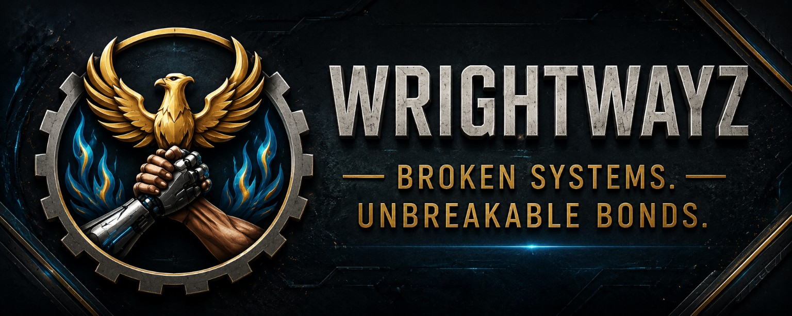

**Founder · Full-stack web developer · Practical AI tools · Automation · Community technology**

Gold Coast, Queensland, Australia · Studying Computer Science at Griffith University

**[The Solo Service Provider](https://thesoloserviceprovider.com.au/) · [LinkedIn](https://www.linkedin.com/in/joshuawright-solo) · [WrightWayz](https://www.wrightwayz.com/) · [Email](mailto:superadmin2712@gmail.com)**

I design, build and run practical software for people who work for themselves: online shops, payment and delivery systems, calculators, business toolkits and automation. I also develop community technology through **WrightWayz**. I build things end to end, test them properly, and say clearly what each product does today.

## The Solo Service Provider: live

**WORK SMARTER. GO FURTHER.** Practical digital tools for Australian sole traders and small service businesses.

**What's live:**

- **[SOLO online shop](https://thesoloserviceprovider.com.au/shop/)**: 16 ready-to-use digital toolkits for quoting and invoicing, cashflow, bookings, customer support, operations and AI workflows. They include four **Trade Editions** set up for cleaners, handymen, lawn and garden businesses and mobile dog groomers. Every toolkit is a one-off purchase with a 30-day money-back guarantee.
- **[Free hourly rate calculator](https://thesoloserviceprovider.com.au/rate-calculator.html)**: works out what a sole trader needs to charge after super, business costs, time off and unbillable hours.
- **[Revenue Rescue](https://thesoloserviceprovider.com.au/revenue-rescue.html)**: a service that helps local businesses turn more website visitors into paid jobs.
- **SOLO AI**: a practical AI assistant for small businesses, in development and not yet publicly available.

**What I built behind it (private repository):**

- A static website and shop on **Vercel**, with **Node.js serverless functions** for checkout, webhooks and downloads.
- **Stripe** checkout and webhooks, with idempotent event handling and refund processing.
- **Supabase (PostgreSQL)** for orders and access grants, with row-level security and service-role-only access.
- Secure, expiring download links, emailed access-link recovery, and **Klaviyo** email automation.
- Privacy-aware analytics and ad tracking with **GA4**, **Google Ads** and **Meta Pixel**. They respect Global Privacy Control and Do Not Track, and use a strict Content Security Policy.
- A generated product-page build, SEO and social share cards, and **300+ automated tests** run on every deploy.

## Other projects

### [AI Download Centre](https://joshuawayzwright.github.io/ai-download-center/)

A live public directory of AI models, assistants and tools, with links to official providers and download sources. The repository also holds the SOLO AI app work, including Android builds in Kotlin and Java.

**[Open the directory](https://joshuawayzwright.github.io/ai-download-center/) · [Source](https://github.com/joshuawayzwright/ai-download-center) · [Submit a tool](https://github.com/joshuawayzwright/ai-download-center/issues/new?template=submit-tool.yml)**

### [ProjectForge AI](https://joshuawayzwright.github.io/projectforge-ai/)

A project planning and learning workspace with eight browser tools: Prompt Vault, Idea Canvas, Priority Coach, Study Cards, Content Planner, Research Tracker, GitHub Live Hub and Workflow Lab. It runs in the browser with local storage. The GitHub hub reads public GitHub data; it has no model inference or cloud sync.

**[Open ProjectForge](https://joshuawayzwright.github.io/projectforge-ai/) · [Source](https://github.com/joshuawayzwright/projectforge-ai)**

### [WrightWayz website](https://www.wrightwayz.com/)

The website for WrightWayz, with information about peer and community support, a support enquiry form and free browser tools. Built as a static site on Vercel with automated Python tests.

## Skills and technologies

| Area | Tools and skills |
|---|---|
| **Languages** | JavaScript (Node.js), HTML5, CSS3, SQL (PostgreSQL), Python, Kotlin and Java (Android), Bash, PowerShell |
| **Platforms** | Vercel (serverless functions), Supabase, Stripe, GitHub Actions, GitHub Pages |
| **Integrations** | Stripe Checkout and webhooks, Klaviyo, Google Analytics 4, Google Ads, Meta Pixel and Ads, Gemini API |
| **Practices** | Automated testing, secure payment and delivery flows, row-level security, Content Security Policy, privacy by design, SEO, accessibility, responsive design |
| **Business** | Product design and pricing, e-commerce, email marketing, digital advertising, small-business operations |

## WrightWayz

**Broken Systems. Unbreakable Bonds. · #WeWalkAsOne**

WrightWayz is my separate Gold Coast community initiative, focused on lived experience, recovery, connection and responsible technology. The AI Bridge and a physical community hub are in development or planning.

Commercial products and WrightWayz keep separate identities, governance, funds and data. WrightWayz is not an emergency or clinical service.

**[Explore WrightWayz](https://www.wrightwayz.com/)**

## How I build

- **Useful tools:** solve a real problem for a real person, then make it simple.
- **Tested before it ships:** automated tests and a real end-to-end purchase before launch.
- **Honest about status:** I clearly separate what's live, what's in private testing and what's planned.
- **Responsible systems:** protect credentials, respect privacy, and keep community and commercial work separate.

## Contact

**Joshua Wright** 
**Email:** [superadmin2712@gmail.com](mailto:superadmin2712@gmail.com) · Business: [hello@thesoloserviceprovider.com.au](mailto:hello@thesoloserviceprovider.com.au) 
**Phone:** [0452 272 820](tel:+61452272820) · International: +61 452 272 820 
**LinkedIn:** [linkedin.com/in/joshuawright-solo](https://www.linkedin.com/in/joshuawright-solo) 
**Location:** Gold Coast, Queensland, Australia

When you get in touch, please name **The Solo Service Provider**, **SOLO AI**, **AI Download Centre**, **ProjectForge** or **WrightWayz** so your message reaches the right project.

---

**REAL TOOLS. REAL RESULTS.**

Profile updated **14 November 2026** · [Profile audit and earlier status notes](PROFILE-AUDIT.md) · [Original artwork sources](assets/README.md)

